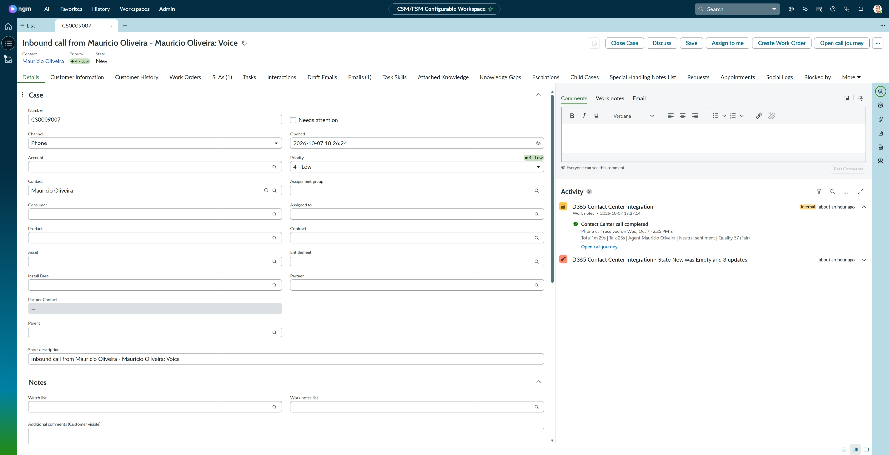
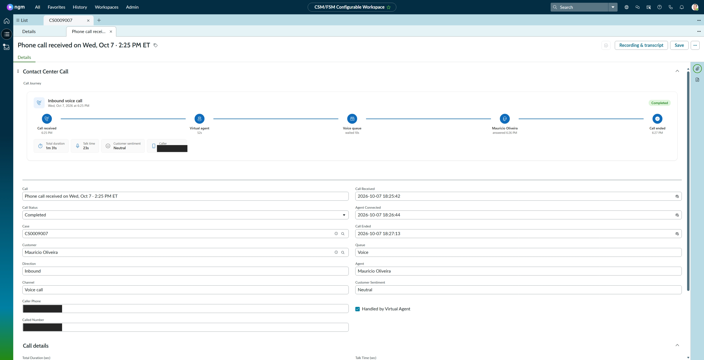
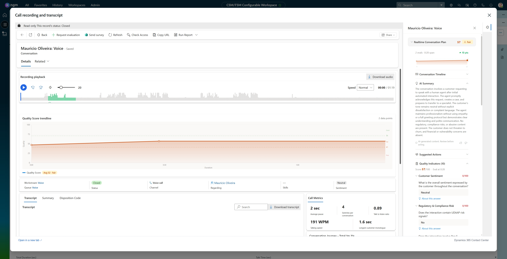
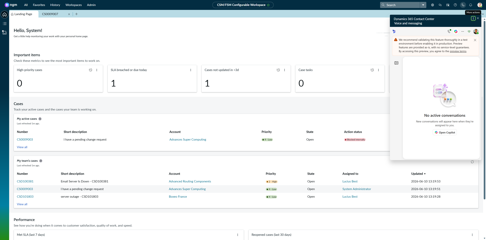
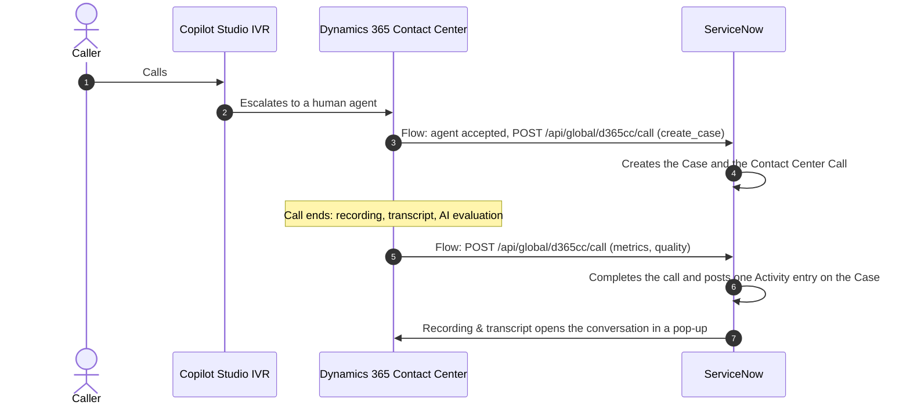
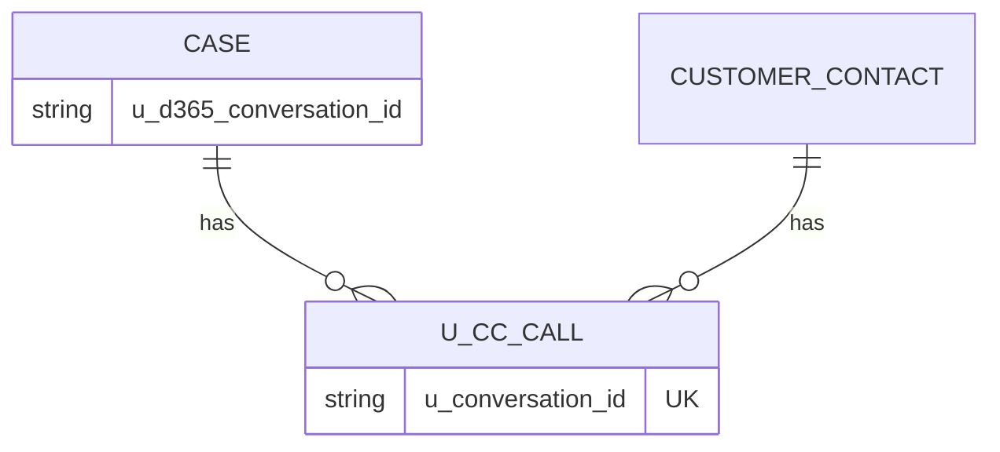

# Dynamics 365 Contact Center × ServiceNow — Call Journey

**Your agents work in ServiceNow. Your calls run on Dynamics 365 Contact Center.**
Every phone call lands on the ServiceNow Case with its full story, and one click opens the Dynamics 365 recording, transcript and AI quality evaluation **inside ServiceNow**.

This is the ServiceNow port of the [Salesforce Call Journey](https://github.com/moliveirapinto/d365-contact-center-salesforce-call-journey). Built and tested on the **CSM/FSM Configurable Workspace** (Zurich). **New in 1.1.0: an ITSM edition** for instances that use **Incidents** and ServiceNow **users** as callers and do **not** have Customer Service Management. See [Which edition do I need?](#which-edition-do-i-need).

### 1. The Case: one **Open call journey** button, and a log entry for every call



### 2. The Contact Center Call record: the call journey on top, one **Recording & transcript** button



### 3. Recording & transcript: the Dynamics 365 conversation, full size, inside ServiceNow



---

> **Download the install packages from the [latest release](https://github.com/moliveirapinto/d365-contact-center-servicenow-call-journey/releases/latest)** (ServiceNow update set + Dynamics 365 solution), then follow [Install, step by step](#install-step-by-step), or [let an AI assistant install it for you](#let-an-ai-assistant-install-it-for-you) by pasting one prompt.

---

## Which edition do I need?

Pick one update set. Everything on the Dynamics 365 side (the solution and its two flows) is the same for both.

| | **CSM edition** | **ITSM edition** |
|---|---|---|
| Your instance has | Customer Service Management (table `sn_customerservice_case`) | ITSM only: `incident` and `sys_user`, no CSM |
| An accepted call creates | a **Case** | an **Incident**, with the caller set |
| The caller is looked up in | customer contacts (`customer_contact`); one is created if nobody matches | ServiceNow **users** (`sys_user`), by phone, e-mail or name; **no user is ever created** (the caller is written in the Incident description when nobody matches) |
| Update set | `D365_ContactCenter_CallJourney_ServiceNow_UpdateSet_1.1.0_CSM.xml` | `D365_ContactCenter_CallJourney_ServiceNow_UpdateSet_1.1.0_ITSM.xml` |
| Integration user role | `sn_customerservice_agent` | `itil` |
| Tested on | Zurich (1.0.3) and Australia (1.1.0), CSM/FSM Configurable Workspace; upgrade from 1.0.3 tested | Australia (1.1.0), classic UI / Next Experience form; see [ITSM edition: what is different](#itsm-edition-what-is-different) |

Both editions show the same softphone (the Dynamics 365 Contact Center Edge desktop in OpenFrame). **Do not import both** on the same instance.

## Contents

1. [Which edition do I need?](#which-edition-do-i-need) and [What you get](#what-you-get)
2. [What is in this repository](#what-is-in-this-repository)
3. [Before you start](#before-you-start) (including how to get a free ServiceNow instance and how to install the connector)
4. [Let an AI assistant install it for you](#let-an-ai-assistant-install-it-for-you)
5. [Install, step by step](#install-step-by-step)
   * [Step 1 – ServiceNow: import the update set](#step-1--servicenow-import-the-update-set)
   * [Step 2 – ServiceNow: set your Dynamics 365 address](#step-2--servicenow-set-your-dynamics-365-address)
   * [Step 3 – ServiceNow: create the integration user](#step-3--servicenow-create-the-integration-user)
   * [Step 4 – Dynamics 365: import the solution](#step-4--dynamics-365-import-the-solution)
   * [Step 5 – Dynamics 365: connect and turn the flows on](#step-5--dynamics-365-connect-and-turn-the-flows-on)
   * [Step 6 – Softphone in the ServiceNow Workspace](#step-6--softphone-in-the-servicenow-workspace)
   * [Step 7 – Copilot Studio (optional)](#step-7--copilot-studio-optional)
6. [Test it](#test-it)
7. [Troubleshooting](#troubleshooting)
8. [Alternative: scripted install](#alternative-scripted-install)
9. [How it works](#how-it-works)
10. [Data model](#data-model)
11. [Settings](#settings)
12. [Uninstall](#uninstall) and [ITSM edition: what is different](#itsm-edition-what-is-different)
13. [Notes and limits](#notes-and-limits)

---

## What you get

| Where | What the agent sees |
|---|---|
| **Case header** | One button, **Open call journey**. One call on the Case: it opens that call as a sub tab. Several calls: a **Calls on this case** pop-up lists them (date, time, direction, agent, duration, sentiment, quality score, status) and the one you pick opens as a sub tab. |
| **Case Activity stream** | **One entry per call**, posted when the call completes: *Contact Center call completed* with total and talk time, agent, sentiment and the AI quality score, plus an **Open call journey** link. |
| **Contact Center Call record** | The **Call Journey** card on top (received → virtual agent → queue → agent → ended, with duration, talk time, sentiment and caller), then the call fields. One **Recording & transcript** button in the header. |
| **Recording & transcript** | A large pop-up with the Dynamics 365 conversation: audio player and waveform, transcript, call metrics, quality trendline and the AI evaluation side pane. |
| **Workspace top bar** | A phone icon that opens the **new Dynamics 365 Contact Center Edge desktop** (inbox, conversations, presence, outbound calls, Copilot) as a 480 px side panel, through ServiceNow OpenFrame. The ServiceNow record stays visible next to it. |
| **Classic UI** | A *Contact Center Calls* related list on the Case and on the Customer Contact. |

The table above describes the CSM edition. In the [ITSM edition](#itsm-edition-what-is-different) the record is an **Incident** and the buttons are on the classic Incident form.

Calls reach ServiceNow by themselves: when an agent accepts a voice call in Dynamics 365 a **Case and a call record are created**, and when the call ends the **metrics and the AI quality evaluation** are added.

## What is in this repository

| Folder / file | What it is |
|---|---|
| [`servicenow/package/D365_ContactCenter_CallJourney_ServiceNow_UpdateSet_1.1.0_CSM.xml`](servicenow/package) and [`D365_ContactCenter_CallJourney_ServiceNow_UpdateSet_1.1.0_ITSM.xml`](servicenow/package) | **ServiceNow update sets** (one per [edition](#which-edition-do-i-need)), the whole ServiceNow side in one file: table `u_cc_call` and its fields, Case (or Incident) fields, Script Includes, Business Rules, UI Pages and Actions, the Case button and call picker, form layouts, related lists, the softphone (OpenFrame configuration plus the Edge host page `d365cc_edge` and script `d365cc_edge_host`), the REST API and the system properties. |
| [`servicenow/package/post-install-fix-script.js`](servicenow/package/post-install-fix-script.js) | Optional repair script (also inside the update set): re-creates the form layout, related lists and softphone, and gives you the softphone role. You do not need it after a normal install. |
| [`dynamics365/D365ContactCenter_ServiceNow_CallJourney_1_0_1_0.zip`](dynamics365) | **Dynamics 365 solution** (unmanaged): the two Power Automate flows, a connection reference and three environment variables for the ServiceNow address and login. No credentials inside. |
| `servicenow/src/`, `deploy/` | Source of everything above and a scripted installer (see [Alternative: scripted install](#alternative-scripted-install)). |
| `docs/images/` | Screenshots used in this README. |

## Before you start

You need:

* A **ServiceNow instance**: with **Customer Service Management** (CSM) and the **CSM/FSM Configurable Workspace** for the CSM edition, or with **ITSM** (Incidents) for the ITSM edition (no CSM needed). You must be able to sign in as `admin` (or a user with the `admin` role).
* A **Dynamics 365 Contact Center** environment with voice, and permission to import solutions and run Power Automate flows there.
* The **same Microsoft Entra account** signed in to Dynamics 365 in the agent's browser. The softphone panel and the recording pop-up show Dynamics 365 inside ServiceNow, so the agent must be able to sign in to Microsoft from that browser: allow pop-ups for your ServiceNow host, and third-party cookies for `*.powerplatform.com`, `*.dynamics.com` and `*.microsoftonline.com` if your browser blocks them.
* These two values, which you will use several times:

  | Value | Example |
  |---|---|
  | ServiceNow instance host name | `dev12345.service-now.com` |
  | Dynamics 365 environment URL | `https://contoso.crm.dynamics.com` |

> **Try it on a non-production instance first.** This is a community sample, not an official Microsoft or ServiceNow product.

### Don't have a ServiceNow instance? Get a free one

ServiceNow has no public trial, but there are two free routes. Both give you an instance you can sign in to as `admin`.

**Option A: Personal Developer Instance (PDI), the standard way**
1. Create a free account at **https://developer.servicenow.com** (**Sign up and start building**) and verify your email.
2. Sign in, accept the Developer Program terms and click **Request an instance**. Choose the **latest release** offered.
3. **Be aware:** at busy times requests are put on a **waitlist** (it can take hours or days) and you get an email when the instance is ready. A PDI is **reclaimed after 10 days of inactivity**, so log in at least once a week. Developer-program instances come with an `admin` login, and the page shows your instance name (for example `dev12345`), URL and password.
4. A PDI does not always include Customer Service Management. In the instance, go to **All → System Applications → All Available Applications → All** and search for **Customer Service** (also called *CSM*) and the **CSM/FSM Configurable Workspace**. If they are not installed, click **Install** and wait until the installation finishes. If you cannot find them there, use Option B.

**Option B: a ServiceNow University lab instance (includes CSM and ITSM)**
1. Create a free ServiceNow ID at **https://learning.servicenow.com** (**Sign In → New user? Get a ServiceNow ID**), verify your e-mail and sign in.
2. Find the free on-demand course **Customer Service Management (CSM) Essentials** (**Explore catalog → Customer Service Management**, newest release listed, for example *Australia*) and click **Start → Enroll**. Enrolling asks you to accept the ServiceNow Training and Certification Terms. It costs 0 USD.
3. The course opens on a page with **Request Lab Instance**. Click it: the instance is ready in about a minute. **Open My Instance** logs you in as `admin`, and the address in the browser (for example `nowlearning-nlinst0xxxxxxx-xxxxx-0001.lab.service-now.com`) is your host name. CSM, ITSM and the Workspace are already there.
4. **Be aware:**
   * A lab instance is **temporary: about 5 days**, with one **Request Expiry Extension** available. Install this package right after you get it. You can request a new instance (the course shows how many you have left).
   * It **pauses when idle**. If the address shows *Your instance is hibernating* or HTTP 502, go back to the course page, click **Wake Up Instance** and wait until the status is **Running** (a few minutes).

Whichever you choose:
- Note the **instance host name** (for example `dev12345.service-now.com`, or the lab host name) and the `admin` login. You enter the password only in the browser, never in the AI chat.
- Check that it works: open `https://<your host>/now/cwf/agent/home`. You should see the Customer Service Workspace. If it shows *page not found* or no Workspace, CSM or the Configurable Workspace is not active yet.
- Use it for testing only, with no real customer data.
- ServiceNow changes these sign-up pages from time to time. If a link has moved, search for *"ServiceNow Developer Program personal developer instance"*.
---

### Need help installing the ServiceNow connector?

The call journey shows the **new Dynamics 365 Contact Center Edge desktop** (inbox, conversations, presence, outbound calls and Copilot) as a side panel in the ServiceNow Workspace, through ServiceNow **OpenFrame**. **The update set in this repo installs it for you** (Step 1), so most people never need this section. Use the prompt below if you want only the panel, without the call journey, or if the panel does not open after the install. Paste it into **Claude** (with browser or computer use), **Claude Code**, or a similar agent.



Microsoft ships the Edge desktop for Salesforce as a package (with a `04t…` install link). **ServiceNow needs no Microsoft package and no install link.** The Edge portal only starts when the page around it answers its start-up handshake. In Salesforce, Microsoft's `d365EdgeContainer` component does that. Here a small ServiceNow page, **`/d365cc_edge.do`**, does it. OpenFrame shows that page, and the page shows the Edge portal.

It sets up:

1. **OpenFrame** in ServiceNow (activates the plugin if needed),
2. the **host page** `d365cc_edge` and its script `d365cc_edge_host` (from this repo),
3. the **OpenFrame configuration** "Dynamics 365 Contact Center" that shows `/d365cc_edge.do`,
4. the **role** `sn_openframe_user` for the people who need the panel,
5. the **Dynamics 365 side**: Contact Center and voice channel, agent licenses and roles, and the content security policy that lets ServiceNow show Dynamics 365,
6. a final **check** that the panel loads and signs in.

> ✅ **Nothing to edit.** Paste the prompt exactly as it is. It starts by **asking you** for your ServiceNow instance address, your Dynamics 365 environment URL and who needs the panel. Anything in `<angle brackets>` is filled in by the assistant. You sign in yourself, including MFA, and never type a password into the chat.

````text
You are a ServiceNow and Dynamics 365 installation engineer. Set up the "Dynamics 365 Contact Center" softphone panel, using the NEW Dynamics 365 Contact Center Edge desktop, in MY ServiceNow instance through ServiceNow OpenFrame, and make sure the Dynamics 365 side is ready for it. Work carefully, change only what is listed, and verify every step.

REFERENCE
- Repository: https://github.com/moliveirapinto/d365-contact-center-servicenow-call-journey. Its README (https://raw.githubusercontent.com/moliveirapinto/d365-contact-center-servicenow-call-journey/main/README.md) explains the design. The host page source is in deploy/steps/08-edge.mjs (constants PAGE and HOST_SCRIPT): https://raw.githubusercontent.com/moliveirapinto/d365-contact-center-servicenow-call-journey/main/deploy/steps/08-edge.mjs
- Why a host page: the Edge portal (https://portal.us.contactcenterai.powerplatform.com/experience/agent) with ?embedded=true posts "d365edge:ping" to its parent frame and waits for a "d365edge:init" answer carrying the Dynamics 365 org URL. Pointing OpenFrame straight at the portal therefore shows "Application Failed to Load". The page /d365cc_edge.do frames the portal and answers. No Microsoft package or 04t install link is needed on ServiceNow.
- Microsoft's Edge install guide for Salesforce (salesforce-edge/MICROSOFT-INSTALL-GUIDE.md in https://github.com/moliveirapinto/d365-contact-center-salesforce-call-journey) is the source of truth for the portal URL, layout presets and sign-in. If this prompt disagrees with it, follow the guide, tell me what differs, and continue.
- Values this install uses (tested and working, 2026-10-08):
  * UI Script (sys_ui_script): Name d365cc_edge_host; Active true; Global false; UI type All; Script = HOST_SCRIPT from 08-edge.mjs, copied exactly.
  * UI Page (sys_ui_page): Name d365cc_edge; Direct true; Category general; HTML = PAGE from 08-edge.mjs WITHOUT its first line (<?xml ... ?>), copied exactly.
  * System Properties (string): d365cc.org_url = my Dynamics 365 URL without a trailing slash; d365cc.edge_url = https://portal.us.contactcenterai.powerplatform.com/experience/agent (or my regional portal URL); d365cc.edge_layout = compact.
  * OpenFrame configuration (table sn_openframe_configuration): Name "Dynamics 365 Contact Center"; Title "Dynamics 365 Contact Center"; Subtitle "Voice and messaging"; URL /d365cc_edge.do (exactly this relative path); Width 480; Height 700; Order 100; Active true; Default true; Show presence indicator false; Collapsed view enabled false; Enforce sandbox restrictions false.
  * Role to give each user: sn_openframe_user.

HOW TO WORK
- Use the tools you have (browser, shell). If you cannot operate a browser, switch to GUIDE MODE: give me ONE step at a time with exact click paths, wait for me to say "done", and verify what I report before moving on.
- Never guess. If a screen or value differs from this prompt, STOP and tell me exactly what you see.
- Retry a failed action at most twice, then stop and show me the exact error.
- I sign in myself, including MFA. Never ask me to paste passwords or tokens in this chat and never store any. Do your ServiceNow checks inside my signed-in browser session (for example open /api/now/table/... URLs as GET requests, or use the list views).
- Do not delete or change anything that is not listed here. Never touch a different ServiceNow instance or Dynamics 365 environment.
- After each step give a one-line status: OK / WARNING / FAILED.

STEP 0 - QUESTIONS (ask all in one message, then wait)
1. ServiceNow instance host name (for example dev12345.service-now.com). Is it a non-production instance? If production, warn me and continue only after I answer "yes, production".
2. My Dynamics 365 Contact Center environment URL (for example https://contoso.crm.dynamics.com). Use it exactly as given, without a trailing slash and without a path.
3. My region's Edge portal URL, if my Microsoft contact gave me one. Otherwise use https://portal.us.contactcenterai.powerplatform.com/experience/agent.
4. Which ServiceNow users (user names or e-mails) must see the panel? Which Dynamics 365 agents will use it?
5. Confirm I can sign in as: (a) a ServiceNow administrator (role admin), (b) a Dynamics 365 / Power Platform administrator for the environment above, (c) a Dynamics 365 Contact Center agent (to test the sign-in at the end).
6. Does my instance have Customer Service Management and the CSM/FSM Configurable Workspace (open https://<host>/now/cwf/agent/home), or is it ITSM only (Incidents)? If you can check it yourself, do so and tell me instead of asking. The panel works in both; ITSM-only instances do not have the Workspace, so the panel then appears in the classic UI / Next Experience top bar.

STEP 1 - PREFLIGHT (read-only; tell me before changing anything)
1. Sign in to the instance in the browser (I complete it).
2. OpenFrame plugin: All > System Definition > Plugins, search "OpenFrame". Also check that https://<host>/api/now/table/sn_openframe_configuration?sysparm_limit=5 answers with JSON (a "Table not found" or 404 error means OpenFrame is not active) and that the role exists: https://<host>/api/now/table/sys_user_role?sysparm_query=name=sn_openframe_user.
3. Existing records: list https://<host>/api/now/table/sn_openframe_configuration?sysparm_fields=sys_id,name,url,active, https://<host>/api/now/table/sys_ui_page?sysparm_query=name=d365cc_edge&sysparm_fields=sys_id,name and https://<host>/api/now/table/sys_ui_script?sysparm_query=name=d365cc_edge_host&sysparm_fields=sys_id,name. If any of them already exists (the call journey update set of this repo creates the same records), STOP and ask me whether to update it. Never create a second record with the same name.
4. CSM instances only: https://<host>/now/cwf/agent/home must open the Customer Service Workspace. On an ITSM-only instance skip this check.

STEP 2 - ACTIVATE OPENFRAME (only if STEP 1 showed it inactive)
All > System Applications > All Available Applications > All, or System Definition > Plugins: search "OpenFrame", open it, click Activate/Install and wait until it finishes (it can take several minutes; do not click twice). Ask me to confirm before activating on a production instance. Repeat the checks of STEP 1.2 and report.

STEP 3 - HOST PAGE
1. Download 08-edge.mjs (link in REFERENCE). Copy the text between the backticks of HOST_SCRIPT and of PAGE exactly. In PAGE, a dollar sign is written as \${...} inside the JavaScript file: in ServiceNow it must be ${...} (remove the backslash). Also drop PAGE's first line, <?xml version="1.0" encoding="utf-8" ?>.
2. All > System UI > UI Scripts > New: fill the UI Script values from REFERENCE and paste HOST_SCRIPT. Submit.
3. All > System UI > UI Pages > New: fill the UI Page values from REFERENCE and paste PAGE into HTML. Submit.
4. System Properties (sys_properties.list): create or update d365cc.org_url, d365cc.edge_url and d365cc.edge_layout with the values from REFERENCE (type string).
5. VERIFY: open https://<host>/d365cc_edge.do in a new tab. Expected: a Microsoft sign-in, or the Contact Center workspace with "No active conversations". If it says "Set the system property d365cc.org_url...", d365cc.org_url is empty or still the placeholder. If it shows ${jvar_org} or a Jelly error, the PAGE text was not copied exactly (check the \${ step).

STEP 4 - OPENFRAME CONFIGURATION
1. Navigate: All > OpenFrame > Configurations (or type sn_openframe_configuration.list in the filter navigator). Click New (or open the existing record if I said to update it).
2. Fill the fields from REFERENCE. Keep the name EXACTLY "Dynamics 365 Contact Center" so the call journey package updates this record instead of creating a duplicate. Submit.
3. VERIFY: reload the list; exactly one record with that name, Active true, URL /d365cc_edge.do, Width 480, Height 700.
4. Open https://<host>/cache.do once (it flushes the server cache; OpenFrame configurations are cached and the panel would otherwise keep the old version).

STEP 5 - ROLE FOR USERS
Give the role sn_openframe_user to every user I named: User Administration > Users > the user > Roles tab > Edit > add the role > Save. VERIFY with https://<host>/api/now/table/sys_user_has_role?sysparm_query=role.name=sn_openframe_user&sysparm_fields=user.user_name and compare to my list.

STEP 6 - DYNAMICS 365 SIDE (the panel only works if this is in place; check each item and report)
Sign-in: ask me to sign in at https://admin.powerplatform.microsoft.com with a Dynamics 365 / Power Platform administrator account, and use the environment I named. Menu names change between releases; if a name differs, search for it and tell me what you found.
1. Contact Center is installed and has a voice channel. Power Platform admin center > Environments > my environment > Resources > Dynamics 365 apps: "Dynamics 365 Contact Center" (and the "Copilot Service admin center" app) must be installed. Open the Copilot Service admin center and confirm under Customer support > Workstreams (and Channels) that a workstream of type Voice exists with a phone number or an Azure Communication Services resource. If not, STOP: the connector cannot work without Contact Center and a voice channel, and setting that up is a separate Microsoft guide (Learn: "Set up Dynamics 365 Contact Center"); tell me.
2. Agents. Every person who will use the panel needs (a) a Dynamics 365 Contact Center (or Customer Service Enterprise + Omnichannel) license, (b) a Dynamics 365 user in this environment with the security role "Omnichannel agent" (or "Customer Service Representative"), and (c) membership in a queue/workstream that receives voice calls. Check each user I listed in Step 0 and report what is missing. Do not change roles or licenses without my "yes".
3. Allow ServiceNow to frame Dynamics 365 (needed for the Recording & transcript pop-up of the call journey). Power Platform admin center > Environments > my environment > Settings > Product > Privacy + Security > "Content security policy" > "App (model-driven)" tab. If "Enforce content security policy" is Off, nothing is needed: note that and go on. If it is On, the frame-ancestors list must include https://<my instance host> and https://*.service-now.com (and my custom ServiceNow domain if I use one). Keep the existing entries and show me the exact list before saving. The Edge portal itself already allows being framed by https://*.service-now.com; nothing to configure for it.
4. Browser. The agent signs in to Microsoft in a pop-up the first time. Pop-ups must be allowed for my ServiceNow host and for portal.us.contactcenterai.powerplatform.com (or my regional portal) and login.microsoftonline.com. Third-party cookies must be allowed for [*.]powerplatform.com, [*.]dynamics.com and [*.]microsoftonline.com (Edge: Settings > Cookies and site permissions; Chrome: Settings > Privacy and security > Third-party cookies > Sites that can always use cookies). For voice calls the browser asks once for the microphone on the portal origin: Allow. If my company manages the browser by policy, tell me to ask IT.
5. Production caution: none of the items above change live calls, but the frame-ancestors change affects who can embed Dynamics 365. Say so and get my "yes" before saving it in a production environment.

STEP 7 - FIRST LOAD AND CHECK
1. Tell me to hard-refresh the Workspace (Ctrl+Shift+R) at https://<host>/now/cwf/agent/home. A phone icon appears in the top bar.
2. Click it. Expected: a 480 x 700 side panel with the Contact Center workspace: a header with the outbound call button, the Copilot icon and my presence, and "No active conversations". The first time a Microsoft sign-in pop-up opens; I sign in with my Dynamics 365 agent account. At this width Edge shows one pane at a time; the inbox toggle on the left of the panel switches to the conversation list.
3. No icon: the user lacks sn_openframe_user (STEP 5), the configuration is not Active (STEP 4), the cache was not flushed (/cache.do, STEP 4.4), or the page was not hard-refreshed.
4. "Application Failed to Load" inside the panel: OpenFrame is pointing straight at the portal instead of /d365cc_edge.do (fix STEP 4), or the host script is missing (STEP 3.2). Open https://<host>/d365cc_edge.do on its own to tell which.
5. Panel says "Set the system property d365cc.org_url to your Dynamics 365 URL": set it (STEP 3.4).
6. Pop-up blocked or sign-in loops: allow pop-ups and third-party cookies as in STEP 6.4, and retry in a normal (not private) window. HTTP 400 "Request Too Long": clear the cookies for dynamics.com and microsoftonline.com and retry.
7. Tell me: Edge keeps loading for about 30 seconds after the panel first opens (even when it already shows "No active conversations"). Until then the "Open Copilot" button and the header Copilot icon do nothing. After that both open the Copilot pane ("What can I help with?"), also without a conversation.
8. The browser console shows "Creating a worker from 'blob:...' violates the following Content Security Policy directive". That message comes from Microsoft's portal itself and also appears outside ServiceNow; ignore it unless voice calls fail.

STEP 8 - FINAL REPORT
Give me a table: item (OpenFrame plugin, host page, configuration, roles, Dynamics 365 side, first load) / status (OK, WARNING, FAILED) / what you saw. List exactly what you changed and how to undo it (deactivate the configuration, delete the UI Page d365cc_edge and UI Script d365cc_edge_host if you created them, remove the role from the users, remove any frame-ancestors entries you added). Then tell me the next step: install the call journey package from this README ("Let an AI assistant install it for you").

START with STEP 0.
````

### What this prompt cannot do for you

- It cannot sign in for you or accept the Microsoft sign-in pop-up.
- It installs the panel only. The **screen pop** (opening the customer when a call is accepted), the Cases or Incidents and the call journey come from the update set in [Install, step by step](#install-step-by-step), which also contains this panel: if you need those, skip this prompt and use the one below.
- Buying and assigning Dynamics 365 Contact Center licenses and creating the voice channel are done in Microsoft 365 / Dynamics 365; the prompt checks them and tells you what is missing.
- If your company blocks third-party cookies or pop-ups by policy, your IT team has to allow them for the domains listed in STEP 6.

### Prefer the classic widget?

The older embeddable conversation widget (`ccaas-embed-prod.azureedge.net`) still works in OpenFrame. Point **OpenFrame → Configurations → Dynamics 365 Contact Center → URL** at `https://ccaas-embed-prod.azureedge.net/widget/index.html?dynamicsUrl=<your Dynamics 365 URL>` with Width 400, or run `node deploy/deploy.mjs 04-security` with `D365_WIDGET=classic`. The call journey works the same with either widget.


## Let an AI assistant install it for you

You do not need an instance first: if you have none, the assistant gets you a free one (PHASE 0B). The update set installs the Dynamics 365 Contact Center panel (Edge desktop) too, so you do not need the connector prompt first. Copy the whole prompt below into an AI assistant that can work in a browser and/or run commands (for example **Claude** with computer or browser use, **Claude Code**, or a similar agent). It will ask you a few questions, install both packages, check every step, and report back. If your assistant cannot operate a browser, the prompt switches it to a guided mode where it walks you through each click.

**You stay in control:** you sign in yourself (including MFA), and the assistant stops and asks whenever something is not as expected.

> ✅ **Nothing to edit.** Paste the prompt exactly as it is. The assistant starts by **asking you** for what it needs: your ServiceNow instance address, your Dynamics 365 environment URL, your time zone, and who should see the softphone. Have those ready. Anything in `<angle brackets>` or with an example value (such as `dev12345.service-now.com` or `contoso.crm.dynamics.com`) is filled in by the assistant from your answers. You never type your passwords into the chat: you sign in yourself in the browser, including MFA. The assistant creates the one password the integration needs and keeps it only inside ServiceNow and Power Automate.

````text
You are an installation engineer. Install the community package "Dynamics 365 Contact Center x ServiceNow Call Journey" for me, end to end, carefully and safely.

SOURCE
Repository: https://github.com/moliveirapinto/d365-contact-center-servicenow-call-journey
README (source of truth): https://raw.githubusercontent.com/moliveirapinto/d365-contact-center-servicenow-call-journey/main/README.md
Release v1.1.0 files (A depends on my edition, see PHASE 0 question 8):
  A-CSM) ServiceNow update set for Customer Service Management: https://github.com/moliveirapinto/d365-contact-center-servicenow-call-journey/releases/download/v1.1.0/D365_ContactCenter_CallJourney_ServiceNow_UpdateSet_1.1.0_CSM.xml
  A-ITSM) ServiceNow update set for ITSM only (Incidents, no CSM): https://github.com/moliveirapinto/d365-contact-center-servicenow-call-journey/releases/download/v1.1.0/D365_ContactCenter_CallJourney_ServiceNow_UpdateSet_1.1.0_ITSM.xml
  B) Dynamics 365 solution (the same for both): https://github.com/moliveirapinto/d365-contact-center-servicenow-call-journey/releases/download/v1.1.0/D365ContactCenter_ServiceNow_CallJourney_1_0_1_0.zip
Read the README first. If the README and this prompt disagree, follow the README and tell me. If a newer release exists, use the files the README names and tell me. Section names used below (for example "Troubleshooting") are in that README.

HOW TO WORK
- Use the tools you have (browser, shell, file download). If you cannot operate a browser, switch to GUIDE MODE: give me ONE step at a time with exact click paths, wait for me to say "done", and check what I report before moving on. If you cannot open URLs, ask me to paste the README and download the files myself.
- Never guess. If a screen, value or count differs from what this prompt says, STOP and tell me exactly what you see.
- Retry a failed action at most twice. Then stop and show me the exact error.
- Only do what is listed here. Do not delete or change any other record, setting, flow or solution.
- Sign-in: I sign in myself, including MFA. Tell me when you need it, then wait. Do not ask me to paste my own password or tokens into this chat.
- The only secret you create is the password of the ServiceNow integration user. Generate it (24+ characters, letters, digits and symbols, no quotes or backslashes), use it only in the two places named below, and never write it to a file, log, screenshot, commit or message. At the end tell me where it lives.
- After each phase give me one or two lines of status (OK / WARNING / FAILED) before you continue.
- Lab instances (ServiceNow University) and personal developer instances pause when idle. If a ServiceNow address answers "Your instance is hibernating", HTTP 502 or 503, wake it (the course page, button "Wake Up Instance") and retry after a few minutes. That is not an error in this package.

PHASE 0 - QUESTIONS (ask all in one message, then wait)
1. ServiceNow instance host name, for example dev12345.service-now.com, or "I don't have one yet" (then you get one for me in PHASE 0B).
2. Is this a non-production instance? If it is production, warn me and continue only after I answer an explicit "yes, production".
3. Dynamics 365 Contact Center environment URL (for example https://contoso.crm.dynamics.com) and the environment's name as shown in Power Apps.
4. Optional: the Dynamics 365 Contact Center app id (leave blank if I do not know it).
5. Time zone (IANA name, for example America/New_York) and a short label (for example ET) for call titles.
6. Besides me, which ServiceNow users should see the softphone (user names or e-mails)? "None" is fine.
7. Confirm I can sign in to: (a) ServiceNow as an admin, (b) Power Apps with an account that can import solutions and create connections in that environment.
8. Edition: do my agents work with Cases (Customer Service Management, CSM) or with Incidents (ITSM)? If I do not know, check it yourself in PHASE 1 and tell me. CSM = the table sn_customerservice_case exists. ITSM only = the table incident exists and sn_customerservice_case does not. If both exist (a lab instance has both), ask me which one my agents work in. From here on EDITION is CSM or ITSM and file A is A-CSM or A-ITSM. Never import both editions on one instance.
9. ITSM edition only: which agent interface do my agents use, the classic UI / Next Experience, or the Service Operations Workspace? (It sets the link style in PHASE 3.)

PHASE 0B - GET A FREE SERVICENOW INSTANCE (only if I said I have none; otherwise skip)
ServiceNow has no public trial. There are two free routes. Try ROUTE B first (it includes Customer Service Management and is usually instant). If ROUTE B fails or is unavailable (course not found, lab will not start, no instance address shown, or I am not eligible), tell me in one line and switch to ROUTE A without being asked. If ROUTE A is on a waitlist, tell me to come back when ServiceNow e-mails me, and you can still prepare everything else meanwhile (download files, read the README).
ROUTE B - ServiceNow University lab instance:
1. Open https://learning.servicenow.com. I create the free account and sign in (verification e-mail, password and any MFA are mine; tell me when you need me, then wait).
2. Explore catalog > Customer Service Management: open the free on-demand course "Customer Service Management (CSM) Essentials" (newest release listed), click Start. The Enroll panel shows the ServiceNow Training and Certification Terms: show me, ask for my explicit "yes", and only then click Enroll (it costs 0 USD).
3. The course page shows "Request Lab Instance". Click it and wait until the status is Running (about a minute), then "Open My Instance". It signs in as admin; the browser address is the host name (for example nowlearning-nlinst0xxxxxxx-xxxxx-0001.lab.service-now.com). The lab password is shown only by that sign-in link: never write it into this chat, a file or a message; use it only in the browser session.
4. Tell me: the lab lasts about 5 days (the course page offers one "Request Expiry Extension"), it pauses when idle (button "Wake Up Instance"), and it is for testing only.
ROUTE A - Personal Developer Instance:
1. https://developer.servicenow.com > Sign up and start building > verify the e-mail > sign in > accept the terms > Request an instance (latest release).
2. At busy times there is a waitlist (hours or days) and ServiceNow e-mails me when it is ready, so tell me to come back then. A PDI is reclaimed after 10 days of inactivity.
3. A PDI may not include CSM: in the instance go to All > System Applications > All Available Applications > All, search "Customer Service" and "CSM/FSM Configurable Workspace" and Install them if missing.
Either route: if my agents will use CSM, check that https://<host>/now/cwf/agent/home shows the Customer Service Workspace. For the ITSM edition no Workspace is needed. Testing only, no real customer data.

PHASE 1 - PREFLIGHT
1. Download file B and the file A for my EDITION. Check A is well-formed XML with this many sys_update_xml elements and size: A-CSM 197 elements, 600,428 bytes; A-ITSM 210 elements, 622,521 bytes. Check B is a valid zip containing solution.xml, customizations.xml and exactly two .json files under Workflows/ (8,122 bytes). Sizes and counts differ only if the README names newer files.
2. Ask me to sign in to ServiceNow as an admin. Decide the EDITION (PHASE 0 question 8):
   - CSM: the table sn_customerservice_case exists and the "CSM/FSM Configurable Workspace" is available (https://<host>/now/cwf/agent/home opens). If the Workspace is missing, STOP.
   - ITSM: the tables incident and sys_user exist (they always do) and I confirmed I have no CSM or my agents work in Incidents. Tell me this edition creates Incidents, not Cases.
   If the table u_cc_call already exists, an earlier version is installed. Read its system property d365cc.mode (absent = version 1.0.x, which is CSM). Same edition: tell me it is an upgrade (it updates in place, the settings d365cc.org_url and d365cc.app_id are reset and must be set again in PHASE 3), and continue only after my "yes". A different edition than the one installed: STOP, never mix them.

PHASE 2 - SERVICENOW PACKAGE
1. System Update Sets > Retrieved Update Sets > "Import Update Set from XML" > upload file A-CSM or A-ITSM according to EDITION.
2. Open "D365 Contact Center - Call Journey 1.1.0 (CSM)" or "(ITSM)". State must be Loaded and it must list 197 update records (CSM) or 210 (ITSM).
3. Click "Preview Update Set" and wait until the state is Previewed (the progress dialog says "Succeeded"; it takes up to a minute or two). There must be 0 problems and 0 collisions. If there is any problem, STOP and show it to me. Do not accept or skip problems.
4. Click "Commit Update Set" (confirm the warning about mapping custom tables to an application: it does not apply) and wait until the state is Committed. Do not click twice.
5. Verify, and report each item: table u_cc_call exists; Script Includes D365CCJourney, D365CCUtil, D365CCPlay and D365CCIcons exist; Scripted REST API "D365 Contact Center" is active with POST /api/global/d365cc/call; OpenFrame configuration "Dynamics 365 Contact Center" exists with URL /d365cc_edge.do; UI Page d365cc_edge and UI Script d365cc_edge_host exist; UI Action "Open call journey" exists on sn_customerservice_case (CSM) or incident (ITSM); UI Action "Recording & transcript" exists on u_cc_call; four Business Rules whose names start with "D365CC" exist, each only ONCE (a duplicate means two editions or two versions were mixed: STOP).
6. Open https://<instance>/cache.do once. UI pages and scripts are cached, and an old version can keep running without this.

PHASE 3 - SETTINGS
Set these System Properties (sys_properties.list): d365cc.mode must already be csm or itsm to match EDITION and d365cc.record_table must be sn_customerservice_case (CSM) or incident (ITSM) (the update set sets them; never change them by hand); d365cc.org_url = my Dynamics 365 URL with no trailing slash; d365cc.app_id = the app id if I gave one; d365cc.time_zone; d365cc.time_zone_label. Leave d365cc.edge_url (Edge portal, default US) and d365cc.edge_layout (compact) as they are unless I gave you a regional portal URL. Then open https://<instance>/d365cc_edge.do in a new tab: it must show a Microsoft sign-in or the Contact Center workspace, not "Set the system property d365cc.org_url". If I am upgrading from an earlier version, committing the update set put d365cc.org_url and d365cc.app_id back to their placeholders: set them again.
ITSM edition only: d365cc.record_url controls how links open records. The default opens them in the classic form inside Next Experience (/now/nav/ui/classic/params/target/{table}.do%3Fsys_id%3D{id}). If I said my agents use the Service Operations Workspace, set it to /now/sow/record/{table}/{id}. Keep {table} and {id} exactly.

PHASE 4 - INTEGRATION USER
1. Create a ServiceNow user: User ID d365cc.integration, Active, "Web service access only" ticked.
2. Give it the role sn_customerservice_agent (CSM edition) or itil (ITSM edition). Nothing else.
3. Generate the password and set it INSIDE ServiceNow with the "Set Password" action on the user form (or a server-side script). NEVER set it through the Table API or REST: that stores it in clear text and sign-in then fails.
4. Verify by calling GET https://<instance>/api/now/table/u_cc_call?sysparm_limit=1 with Basic authentication as d365cc.integration. Expect HTTP 200. HTTP 401 means the password was not set correctly: set it again through the form. HTTP 403 means the role is missing (and if it stays 403 with the right role, STOP and tell me what the response says).
5. Check the Dynamics 365 endpoint the same way, with an EMPTY body so nothing is created: POST https://<instance>/api/global/d365cc/call with Basic authentication as d365cc.integration, header Content-Type: application/json and body {}. Expect HTTP 400 with the message "conversation_id is required". That proves the endpoint is live and the user may call it. HTTP 401, 403 or 404 means something is wrong: STOP and tell me. Never send a body that contains a conversation_id; that would create a Case and a call record.

PHASE 5 - DYNAMICS 365
1. Open https://make.powerapps.com, ask me to sign in, and select the environment I named. Confirm it is the Contact Center environment: it must have the table "Conversation" (logical name msdyn_ocliveworkitem). If not, STOP.
   Also check the content security policy that lets ServiceNow show Dynamics 365 in the Recording & transcript pop-up: Power Platform admin center > Environments > my environment > Settings > Product > Privacy + Security > Content security policy > "App (model-driven)" tab. If "Enforce content security policy" is On, the frame-ancestors list must allow https://<my instance host> (or https://*.service-now.com). Show me the list and ask before adding it. If enforcement is Off, nothing is needed. The panel itself (softphone) came with the update set; if it does not open, see PHASE 6 and the section "Need help installing the ServiceNow connector?".
2. Solutions > Import solution > upload file B > Next.
3. On the connections page, create or select a Microsoft Dataverse connection for "D365 Contact Center - Dataverse" (I sign in if asked).
4. Fill the three environment variables: "ServiceNow Instance" = the host name only (no https://); "ServiceNow User" = d365cc.integration; "ServiceNow Password" = the generated password.
5. Import and wait for the success message.
6. Open the solution "D365 Contact Center - ServiceNow Call Journey". Check that the connection reference "D365 Contact Center - Dataverse" is connected. Turn ON both flows: "D365 Contact Center - Create ServiceNow case when an agent accepts a call" (it creates the Case in the CSM edition and the Incident in the ITSM edition; the flow is the same) and "D365 Contact Center - Sync ended calls to ServiceNow". Reload the page and confirm both show On. If a flow asks to fix its connection, fix it and turn it on again.
7. Confirm all three environment variables have a current value. For the password only confirm it is not empty; never display it.

PHASE 6 - SOFTPHONE ACCESS
Give the role sn_openframe_user to me and to the users I listed. Verify each assignment. Open https://<instance>/cache.do once (OpenFrame configurations are cached). Tell them to hard-refresh (Ctrl+Shift+R) the agent interface: the CSM/FSM Configurable Workspace (CSM edition) or the ServiceNow header of their interface (ITSM edition). A phone icon then appears in the header and opens the Dynamics 365 Contact Center Edge desktop in a 480 x 700 side panel. If an ITSM user does not see the icon, check the role sn_openframe_user, that the OpenFrame configuration is active, and that /cache.do was opened; tell me if the interface in use does not show OpenFrame at all. The first time, each agent signs in to Microsoft in a pop-up (allow pop-ups for the ServiceNow host). Tell me that Copilot ("Open Copilot" or the header Copilot icon) responds only once Edge has finished loading, about 30 seconds after the panel first opens.

PHASE 7 - END-TO-END CHECK
Ask me to place a real call to my Dynamics 365 voice number, accept it as an agent, then end it. Do not create fake data. Then check, read-only:
- Within about two minutes of the agent accepting: a new Case exists in sn_customerservice_case (CSM) or a new Incident exists in incident (ITSM) and a row exists in u_cc_call related to it. In the ITSM edition the Incident caller is the ServiceNow user whose phone, e-mail or name matches the Dynamics 365 contact; if nobody matches, the caller is empty and the description names the caller.
- After the call ends: the u_cc_call status is Completed and the Case or Incident Activity stream shows one entry "Contact Center call completed".
- In the Workspace (CSM) or the form (ITSM): the button "Open call journey" opens the call (as a sub tab in the Workspace, as the call list in the classic UI) and "Recording & transcript" on the call opens the recording and transcript pop-up.
- Incoming call (both editions): with the ServiceNow tab minimized or in the background, an incoming Dynamics 365 conversation must open the softphone panel by itself. Tell me to allow notifications for the ServiceNow site once (browser site settings) so a system notification also appears; then ask me to test with the tab minimized.
- Screen pop: accepting the call must open the matching customer (CSM contact or ITSM user) in ServiceNow. If it does not, check the phone number on the ServiceNow customer (the last 10 digits are compared, spaces and dashes do not matter) and on the Dynamics 365 contact, and that /cache.do was opened after the import. In a test you can open https://<instance>/d365cc_find.do?type=contact&phone=<number> while signed in: the page shows <table>|<sys_id> when a customer matches and nothing when none does.
If something is missing, use the Troubleshooting table in the README. Look first at the flow run history in Power Automate, then at the ServiceNow System Log (messages starting with "[D365CC]"). Report what you find; do not change anything else without asking me.

STOP AND ASK ME WHENEVER
- a check in this prompt fails or a count does not match,
- you are asked to sign in, approve MFA, accept terms or pay for anything,
- the target looks like production and I have not said "yes, production",
- you would have to do something that is not in this prompt.

FINAL REPORT
Give me a table with every phase and its result, say which EDITION (CSM or ITSM) and which update set version you installed, then: (1) anything I still have to do by hand, (2) where the integration password is stored (the ServiceNow user record and the Dynamics 365 environment variable "ServiceNow Password") and how to rotate it (set a new password on the user in ServiceNow, then update the environment variable and turn the flows off and on), (3) the link to the README Troubleshooting section, (4) a reminder that this is a community sample, not an official Microsoft or ServiceNow product.
````
## Install, step by step

### Step 1 – ServiceNow: import the update set

1. Download the update set for your [edition](#which-edition-do-i-need) from the [latest release](https://github.com/moliveirapinto/d365-contact-center-servicenow-call-journey/releases/latest) (or the **Download raw file** button on GitHub): [`D365_ContactCenter_CallJourney_ServiceNow_UpdateSet_1.1.0_CSM.xml`](servicenow/package/D365_ContactCenter_CallJourney_ServiceNow_UpdateSet_1.1.0_CSM.xml) for CSM, or [`D365_ContactCenter_CallJourney_ServiceNow_UpdateSet_1.1.0_ITSM.xml`](servicenow/package/D365_ContactCenter_CallJourney_ServiceNow_UpdateSet_1.1.0_ITSM.xml) for ITSM.
2. In ServiceNow open **System Update Sets → Retrieved Update Sets** and click **Import Update Set from XML**.
3. Choose the file and click **Upload**. The update set **D365 Contact Center - Call Journey 1.1.0 (CSM)** or **(ITSM)** appears with state *Loaded*.
4. Open it and click **Preview Update Set**. Wait until the state is *Previewed*. There should be **0 problems**.
5. Click **Commit Update Set**.

> **Upgrading from 1.0.3 or earlier?** Import the **CSM** update set the same way. It adds the edition settings, the screen-pop and incoming-call improvements, and puts `d365cc.org_url` and `d365cc.app_id` back to their placeholders, so set them again in Step 2.

### Step 2 – ServiceNow: set your Dynamics 365 address

Everything else (table, buttons, form layout, related lists, softphone) arrived with the update set. You only tell it where your Dynamics 365 is.

In **System Properties** (type `sys_properties.list` in the navigator) set:

| Property | Value |
|---|---|
| `d365cc.org_url` | Your Dynamics 365 URL, for example `https://contoso.crm.dynamics.com` |
| `d365cc.app_id` | *(optional)* The id of the Contact Center app in your environment |
| `d365cc.time_zone` | IANA time zone used in call titles, for example `America/New_York` |
| `d365cc.time_zone_label` | Short label shown in call titles, for example `ET` |

The **softphone** (the Edge desktop in the OpenFrame panel) reads `d365cc.org_url` by itself. Two more properties came with the update set and usually stay as they are:

| Property | Default | Change it when |
|---|---|---|
| `d365cc.edge_url` | `https://portal.us.contactcenterai.powerplatform.com/experience/agent` | Your Microsoft contact gave you another regional Edge portal URL |
| `d365cc.edge_layout` | `compact` | You want no header in the panel (`embedded`), or `full` / `minimal` |

The update set also set the edition properties (`d365cc.mode`, `d365cc.record_table`, `d365cc.customer_table`, `d365cc.customer_field`, `d365cc.account_table`, `d365cc.create_customer`, `d365cc.record_url`). Leave them as they are, except `d365cc.record_url` (see [ITSM edition: what is different](#itsm-edition-what-is-different)).

> If something looks incomplete, you can run the optional repair script: **System Definition → Fix Scripts → D365CC - Post-install configuration → Run Fix Script**. It is safe to run any number of times.

### Step 3 – ServiceNow: create the integration user

Dynamics 365 uses this user to send calls to ServiceNow.

1. **User Administration → Users → New**. User ID `d365cc.integration`, tick **Web service access only**.
2. Give it the role **`sn_customerservice_agent`** (CSM edition) or **`itil`** (ITSM edition).
3. **Set the password inside ServiceNow** (the *Set Password* UI action or a background script). Do not set it through the Table API: that stores it in clear text and sign-in then fails.
4. Keep the user ID and password: you need them in step 5.

### Step 4 – Dynamics 365: import the solution

1. Go to <https://make.powerapps.com>, pick your **Dynamics 365 Contact Center environment**, then **Solutions → Import solution**.
2. Choose [`D365ContactCenter_ServiceNow_CallJourney_1_0_1_0.zip`](dynamics365/D365ContactCenter_ServiceNow_CallJourney_1_0_1_0.zip) and click **Next**.
3. On the connections page, **create or choose a Microsoft Dataverse connection** for *D365 Contact Center - Dataverse*, and fill the three environment variables:

   | Variable | Value |
   |---|---|
   | **ServiceNow Instance** | Host name only, for example `dev12345.service-now.com` |
   | **ServiceNow User** | `d365cc.integration` (the user from step 3) |
   | **ServiceNow Password** | The password of that user |

4. Click **Import** and wait for the *success* message.

The solution contains two flows:

| Flow | Does |
|---|---|
| **D365 Contact Center - Create ServiceNow case when an agent accepts a call** | Every minute, finds voice calls an agent has accepted and sends them to ServiceNow, which creates the **Case (CSM) or Incident (ITSM) and the call record**. It looks up the customer by phone, e-mail or name; the CSM edition creates a contact when nobody matches, the ITSM edition never creates a user. |
| **D365 Contact Center - Sync ended calls to ServiceNow** | When a voice conversation ends, sends the **timings, sentiment and AI quality evaluation** to ServiceNow. |

> The password is stored as a plain environment variable. For production move it to **Azure Key Vault** (a secret environment variable).

### Step 5 – Dynamics 365: connect and turn the flows on

1. In **Solutions → D365 Contact Center - ServiceNow Call Journey** open **Connection references**, open *D365 Contact Center - Dataverse* and select your connection if it is not set.
2. Open each of the two flows and click **Turn on**. A flow that is off, or has no connection, does nothing.
3. The account that owns the connection must be able to **read voice conversations, contacts and evaluation history** in the environment.

### Step 6 – Softphone in the ServiceNow Workspace (or the ITSM header)

The update set created everything the panel needs: the OpenFrame configuration **Dynamics 365 Contact Center** (URL `/d365cc_edge.do`, 480 x 700), the page `d365cc_edge` that hosts the new Dynamics 365 Contact Center **Edge desktop**, and its script `d365cc_edge_host`. No Microsoft package or install link is needed on ServiceNow.

1. Give every agent who should see the panel the role **`sn_openframe_user`** (User Administration → Users → the user → Roles).
2. Open `https://<your instance>/cache.do` once. OpenFrame configurations are cached, and without this the old panel (or no icon) can stay for a while.
3. Hard-refresh the Workspace (Ctrl+Shift+R). A **phone icon** appears in the top bar. Click it: the Edge desktop opens on the right as a side panel, and the ServiceNow record stays visible.
4. The first time, each agent signs in to Microsoft in a pop-up. Allow pop-ups for your ServiceNow host. On the first voice call the browser asks for the microphone: **Allow**.

At 480 px Edge shows one pane at a time. The toggle on the left of the panel switches to the conversation list, and the panel's **⋮** menu → *Panel Placement* docks it beside the page instead. To make it bigger, change **Width** and **Height** in **OpenFrame → Configurations → Dynamics 365 Contact Center**.

> **Copilot:** the **Open Copilot** button and the header Copilot icon open the Copilot pane, also with no conversation. Edge keeps loading for about 30 seconds after the panel first opens, and until then they do nothing: wait a moment and click again.

### Step 7 – Copilot Studio (optional)

If your IVR runs in Copilot Studio and creates the Case itself, write the conversation id into the ServiceNow Case so the call is linked instead of duplicated:

* Use the ServiceNow connector → **Create record** on table `sn_customerservice_case` (CSM edition) or `incident` (ITSM edition).
* Map the field **`u_d365_conversation_id`** to `Global.msdyn_ConversationId`.

If you skip this, the accept flow creates the Case for you.

---

## Test it

1. Place a call to your Dynamics 365 voice number and let an agent accept it, then end the call.
2. Within about a minute of the agent accepting, a **Case** (CSM edition) or an **Incident** (ITSM edition) appears in ServiceNow with a **Contact Center Call** related to it. In the ITSM edition the Incident **caller** is the user whose phone, e-mail or name matches.
3. When the call ends, the Case or Incident **Activity** shows **Contact Center call completed**.
4. Click **Open call journey**: in the Workspace the call opens as a sub tab with the Call Journey card on top; on the classic Incident form it opens the list of the call(s) of that Incident.
5. On the call click **Recording & transcript**: the Dynamics 365 recording, transcript and evaluation open in a full-size pop-up.
6. **Screen pop:** with the softphone open, accept a call from a number that belongs to a ServiceNow contact (CSM) or user (ITSM): that customer opens in ServiceNow. With the ServiceNow tab minimized, an incoming conversation opens the panel by itself (allow notifications for your ServiceNow site once for a system notification too).

To send a past call again without placing a new one, use the [replay script](#alternative-scripted-install) (`deploy/d365/replay-sync.mjs`).

## Troubleshooting

| Symptom | Cause and fix |
|---|---|
| Nothing arrives in ServiceNow | Check that **both flows are on** and their connection is set. Open the flow's **Run history** in Power Automate. |
| Flow run fails with **401** | The integration user's password was set through the Table API, or the environment variables are wrong. Set the password again inside ServiceNow and re-check the three variables. |
| Flow run fails with **403** | The integration user lacks the role `sn_customerservice_agent` (CSM) or `itil` (ITSM). |
| After an upgrade or an edit, the softphone or the screen pop behaves like the old version | UI scripts and pages are cached: open `https://<instance>/cache.do` once, then hard-refresh the browser (Ctrl+Shift+R). |
| Screen pop opens nothing | Open `https://<instance>/d365cc_find.do?type=contact&phone=<number>` while signed in: it shows `<table>\|<sys_id>` when a customer matches. No match: fill the phone (the last 10 digits are compared, spaces and dashes do not matter) or the e-mail on the ServiceNow contact or user. |
| ServiceNow address says *Your instance is hibernating* (lab or developer instance) | The instance paused when idle. Wake it from the course page (**Wake Up Instance**) or the developer portal and wait a few minutes. |
| Upgrade preview says *Found a local update that is newer than this one* | A record of the package was changed on your instance after it was installed (a local customization). Previewing is read-only: look at which records are listed. Accepting the remote version overwrites your change, so decide record by record; do not skip all. The release itself should show 0 problems on an untouched 1.0.3 install. |
| ITSM: the Incident has no caller | No ServiceNow user matched the Dynamics 365 contact. The match is by phone (last 10 digits of `phone` or `mobile_phone`), then e-mail, then first and last name. Fill the phone or e-mail on the `sys_user` record. The ITSM edition never creates users. |
| No notification when the ServiceNow tab is minimized | The panel opens by itself on an incoming conversation. A system notification is also raised if the browser allows notifications for your ServiceNow site (site settings, Notifications, Allow). |
| No **Open call journey** button on the Case | Reload the Workspace (hard refresh). The button shows on Cases in the CSM/FSM Configurable Workspace. |
| Click **Open call journey** and nothing opens | The call record was deleted, or the Workspace tab was reloaded just before. Reload the Case and try again. |
| The Activity link opens a tab that closes by itself | By design: ServiceNow does not let the Activity stream run scripts, so a short hand-off page asks the Workspace to open the call as a sub tab. The **Open call journey** button on the Case does not do this. |
| **Recording & transcript** pop-up stays blank or asks to sign in | Sign in to Dynamics 365 in the same browser, and allow third-party cookies for `*.dynamics.com`. Check `d365cc.org_url` has no trailing text. |
| No softphone (phone) icon | The user needs the role `sn_openframe_user`; check **OpenFrame → Configurations** that *Dynamics 365 Contact Center* is active. Then open `https://<instance>/cache.do` once and hard-refresh the Workspace: OpenFrame configurations are cached. |
| Panel says **Application Failed to Load** | OpenFrame points straight at the Edge portal. Its URL must be `/d365cc_edge.do` (the page answers the portal's start-up handshake). Open `https://<instance>/d365cc_edge.do` on its own to test the page. |
| Panel says **Set the system property d365cc.org_url** | `d365cc.org_url` is empty or still `https://YOURORG.crm.dynamics.com` (committing an update set resets it). Set it (Step 2). |
| Microsoft sign-in pop-up does not open, or sign-in loops | Allow pop-ups for your ServiceNow host and third-party cookies for `*.powerplatform.com`, `*.dynamics.com`, `*.microsoftonline.com`; use a normal (not private) window. |
| **Open Copilot** does nothing | Edge is still loading (about 30 seconds after the panel first opens, even if the inbox already shows). Wait and click again. If it never opens, check Copilot is enabled for agents in the Copilot Service admin center. |
| Browser console: *Creating a worker from 'blob:...' violates the following Content Security Policy* | Comes from Microsoft's Edge portal itself, also outside ServiceNow. Ignore it unless voice calls fail. |
| Call record form is missing the journey card or the related lists | Run the optional repair script (see step 2). |
| Dynamics 365 widget keeps crashing in the browser | Very large numbers of unread notifications in Dynamics 365 can exhaust the browser: delete old `appnotification` records. |

## Alternative: scripted install

If you prefer scripts to the packages (or want to change the code), requires **Node 18+**:

```powershell
copy .env.example .env.local     # fill in your instance, admin login and Dynamics 365 URL
node deploy/deploy.mjs           # schema, logic, UI, softphone, REST API, call picker, open-call hand-off, Edge host page
```

For an **ITSM-only** instance set `D365_MODE=itsm` first (in `.env.local` or the shell). The default is `csm`.

| Step | Script | Does |
|---|---|---|
| 1 | `deploy/steps/01-schema.mjs` | Table, columns, choices, Case fields, `d365cc.*` settings |
| 2 | `deploy/steps/02-logic.mjs` | Script Includes, Business Rules, calculated fields |
| 3 | `deploy/steps/03-ui.mjs` | UI Page, UI Actions, form layouts (classic + Workspace) |
| 4 | `deploy/steps/04-security.mjs` | OpenFrame configuration (Edge desktop through `/d365cc_edge.do`; `D365_WIDGET=classic` for the older widget) |
| 5 | `deploy/steps/05-rest.mjs` | Scripted REST API for the Dynamics 365 flows |
| 6 | `deploy/steps/06-play.mjs` | Call picker and the Case button |
| 7 | `deploy/steps/07-open.mjs` | Open-call hand-off for the Activity link |
| 8 | `deploy/steps/08-edge.mjs` | Edge host page `d365cc_edge`, script `d365cc_edge_host`, `d365cc.edge_*` settings |
| 9 | `deploy/steps/09-fix.mjs` | The optional repair Fix Script |

All steps are idempotent. Run a subset with `node deploy/deploy.mjs 03-ui`. After changing the softphone, open `https://<instance>/cache.do` once.

To rebuild the update sets (maintainers). Records are matched by their `sys_id` when an update set is committed, so a new release must keep the ids of the previous one or customers end up with every record twice:

* **CSM edition (upgrade of an existing release):** install the previous update set on a lab instance, then run `D365_MODE=csm node deploy/tools/capture-update-set.mjs <version> --base servicenow/package/<previous CSM file>`. `deploy.mjs` updates the installed records in place; the result is merged over the previous file (same record = replaced, new record = added).
* **ITSM edition (first release):** `node deploy/tools/teardown.mjs --yes`, then `D365_MODE=itsm node deploy/tools/capture-update-set.mjs <version>`. The next ITSM release must use `--base` the same way.
* Always test the result by importing it on a clean instance (and, for CSM, over the previous release) and check for duplicates.

Dynamics 365 flows from scripts (needs a Dataverse token in `D365_TOKEN` and the integration password in `SN_INTEGRATION_PASS`):

```powershell
node deploy/d365/create-accept-flow.mjs     # create the Case when an agent accepts
node deploy/d365/create-flow.mjs            # sync metrics when the call ends
node deploy/d365/replay-sync.mjs <conversationId>   # replay one past call
```

## How it works



The REST call is an **upsert** keyed on the Dynamics 365 conversation id, so it does not matter which event arrives first: you always end up with exactly one call record per call.

### Feature parity with the Salesforce version

| Salesforce | ServiceNow (this repo) |
|---|---|
| `Contact_Center_Call__c` object | Table **`u_cc_call`** ("Contact Center Call"), same fields |
| Case fields `D365_Conversation_Id__c`, `D365_Call_Recording__c` | `sn_customerservice_case.u_d365_conversation_id`, `u_d365_call_recording`, `u_call_journey` |
| Custom Setting *D365 Contact Center Settings* | System properties `d365cc.*` |
| Flow *Create Call from IVR case* | Business Rule **D365CC – Create call from IVR case** |
| `callTimeline` LWC | Script Include **`D365CCJourney`**, rendered in the Call Journey field |
| `callRecordingModal` LWC | UI Page **`d365cc_recording`** + UI Action **Recording & transcript** |
| D365 sync flow → Salesforce REST | Scripted REST **`POST /api/global/d365cc/call`** + the two Power Automate flows |
| Microsoft's `d365EdgeContainer` component (Edge desktop) in the utility bar | **OpenFrame** configuration + host page **`d365cc_edge`** (answers the Edge `d365edge:ping` / `init` handshake) |

## Data model

One **Case** has many **calls**. Each call is its own row in `u_cc_call`, related to the Case (`u_case`) and the customer (`u_contact`).



* `u_conversation_id` is unique per call and is the key the flows upsert on.
* `sn_customerservice_case.u_d365_conversation_id` holds the conversation the IVR stamped on the Case; further calls link to the Case by being related to it.
* The AI quality evaluation (score, plan, summary, coaching, details) is stored on the call. The score and band show on the Case Activity entry and in the call picker; the full evaluation is in the Dynamics 365 pop-up.

## Settings

| Property | Meaning |
|---|---|
| `d365cc.org_url` | Dynamics 365 environment URL |
| `d365cc.app_id` | Contact Center app id (optional) |
| `d365cc.time_zone` | IANA time zone used in call titles |
| `d365cc.time_zone_label` | Short label in call titles (for example `ET`) |
| `d365cc.edge_url` | Edge portal URL for your region (default `https://portal.us.contactcenterai.powerplatform.com/experience/agent`) |
| `d365cc.edge_layout` | Edge layout preset: `compact` (default; header with outbound call, presence and Copilot), `embedded`, `full` or `minimal` |

Times inside the Call Journey card and the call picker are shown in each agent's own ServiceNow time zone.

## Uninstall

* **Dynamics 365:** turn the two flows off and delete the solution *D365 Contact Center - ServiceNow Call Journey*.
* **ServiceNow:** deactivate the Business Rules *D365CC – …*, the OpenFrame configuration and the Scripted REST API *D365 Contact Center*; delete the UI Page `d365cc_edge` and UI Script `d365cc_edge_host` if you no longer want the softphone. The table `u_cc_call` and its data can stay; delete it only if you do not need the call history.

## ITSM edition: what is different

For instances that use ITSM only (Incidents, no Customer Service Management), for example when a contact center is replacing a CTI product that works with Incidents and ServiceNow users as callers.

| | |
|---|---|
| **Record created per call** | An **Incident** (`incident`), `contact_type` phone, with the caller (`caller_id`) set when a user matches. |
| **Customer lookup** | `sys_user`: `phone` / `mobile_phone` (last 10 digits), then `email`, then first and last name. The same lookup runs on the **screen pop** when the agent accepts: the matching user opens in ServiceNow. **No user is created.** |
| **Accounts** | A Dynamics 365 account screen pop opens the matching company (`core_company`) by phone or name. |
| **Call journey** | The Call Journey card and the "Contact Center call completed" entry appear in the Incident activity (work notes). The **Open call journey** button opens the call list of the Incident in the classic UI, and the call as a sub tab in a Workspace that supports it. |
| **Links** | `d365cc.record_url` is a template with `{table}` and `{id}`. Default (classic form in Next Experience): `/now/nav/ui/classic/params/target/{table}.do%3Fsys_id%3D{id}`. For the Service Operations Workspace use `/now/sow/record/{table}/{id}`. |
| **Copilot Studio IVR** | If your bot creates the ticket itself, create an **Incident** and write the conversation id into `u_d365_conversation_id`. |
| **Incoming call while minimized** | When Dynamics 365 offers a conversation, the panel opens by itself (OpenFrame `show`). If the browser allows notifications for the ServiceNow site, a system notification is raised too, which helps when the tab is in the background. |

**What was tested (2026-10-22, ServiceNow Australia release, lab instance with CSM and ITSM present, ITSM mode selected).**

* Import of the ITSM update set on a clean instance: preview with 0 problems, commit, no duplicate records, the standard Incident related lists untouched.
* Accepted call through the REST API as the Dynamics 365 flow sends it: Incident created with the caller matched by phone alone (different number format and different name), and with no match the caller stays empty and the description names the caller (no user is created).
* Call end: call record Completed with durations and quality score, one **Contact Center call completed** entry in the Incident activity, journey card and recording link on the Incident.
* Screen pop: the host page asked the server which user matches and opened the user's form (portal events were simulated; the portal itself was not given a real call).
* CSM edition: new install, and upgrade over 1.0.3 (preview 0 problems, no duplicates), accepted call with contact match, contact creation when nobody matches, completion and activity entry.

**Not yet proven with a real call:** the Edge portal's own `conversation.invited` and `screenPop.requested` events (they were simulated), and the system notification with a really minimized browser. Run the end-to-end check in the install prompt once with a real call. The Service Operations Workspace was not tested; set `d365cc.record_url` as described above if your agents use it. Brazil was not tested.

## Notes and limits

* **Short calls (fixed in 1.0.2).** Earlier versions missed calls that ended within about a minute, because the accept flow only looked at calls still open when it ran, so no Case was created. From 1.0.2 the flow also looks at ended calls from the last 30 minutes, and the ServiceNow service gives a call that was synced first its Case. If you installed an earlier version, import the new update set and solution (see Step 1 and Step 4).

* **What is new in 1.1.0.**
  * **ITSM edition** (Incidents, ServiceNow users as callers, no CSM needed), see [Which edition do I need?](#which-edition-do-i-need).
  * **Screen pop fixed.** Before, the lookup of the customer ran in the softphone page without a session token, so ServiceNow rejected it (HTTP 401) and no customer was ever opened. The lookup now runs on the server (`/d365cc_find.do`) with the signed-in agent's own access, and compares phone numbers in any format (spaces, dashes, brackets, with or without country code: the last 10 digits).
  * **Customer match on accepted calls fixed.** The phone match on the call-creation side never matched (it relied on a condition that was silently ignored), so customers were found by name only. Phone, then e-mail, then name now all work.
  * **Incoming call while the tab is minimized:** the panel opens by itself, and a system notification is raised when the browser allows it.
  * **Classic UI:** the **Open call journey** and **Recording & transcript** buttons no longer run when the form opens.
  * **Upgrades keep working:** the 1.1.0 CSM update set reuses the record ids of 1.0.3, so importing it updates in place (tested: no duplicates).

* **Softphone: the new Contact Center Edge desktop (since 1.0.3).** Earlier versions put the classic embeddable widget (`ccaas-embed-prod.azureedge.net`) in OpenFrame. 1.0.3 shows the Edge desktop, the same one the [Salesforce version](https://github.com/moliveirapinto/d365-contact-center-salesforce-call-journey) uses. Pointing OpenFrame straight at the Edge portal does **not** work: with `embedded=true` the portal posts `d365edge:ping` to its parent and shows *Application Failed to Load* unless it gets a `d365edge:init` answer with the Dynamics 365 org (in Salesforce, Microsoft's `d365EdgeContainer` component answers). The page `/d365cc_edge.do` frames the portal and speaks that protocol, the same way. It reads `d365cc.org_url`, `d365cc.edge_url` and `d365cc.edge_layout`. When the portal asks for a screen pop, it opens the matching ServiceNow contact or account (by phone, then e-mail, then name), and it opens the panel when a conversation is offered. The calls, Cases, journey card and recording view come from the Dynamics 365 flows and the Scripted REST API, so they work with either widget. To go back to the classic widget, see [Prefer the classic widget?](#prefer-the-classic-widget). Tested on 2026-10-08 with Edge portal build 2026.10.01 on the Zurich CSM/FSM Configurable Workspace.

* **Icons.** The card uses  [Fluent System Icons](https://github.com/microsoft/fluentui-system-icons) (MIT), embedded inline so they survive ServiceNow's rich-text sanitizer. Regenerate with `node deploy/tools/fetch-icons.mjs`.
* **Case tab strip.** The Workspace tab strip (SLAs, Tasks, Emails…) is configured in UI Builder, not by related-list records, so a *Contact Center Calls* tab has to be added there by hand if you want one. The Case **Open call journey** button already reaches every call.
* **Activity entry icon.** ServiceNow picks the yellow lock icon for work notes; it cannot be changed from here.
* **Secrets.** The flows read the ServiceNow login from environment variables. Use Key Vault for production.
* **Lab instances** from ServiceNow University expire and cannot be shared; a Personal Developer Instance lasts longer. Import the update set again on the new instance.
* This is a community sample, not an official Microsoft or ServiceNow product, and is not supported by either company.
